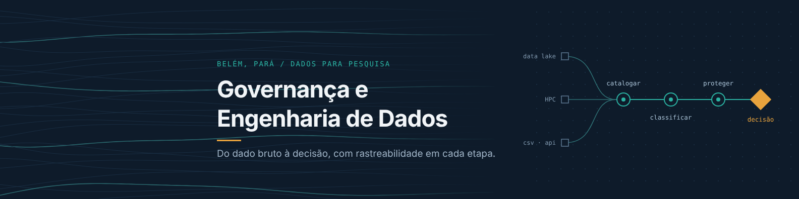

# Tarliso Dória

Analista de Governança de Dados no Instituto Tecnológico Vale (ITV), em Belém (PA). Trabalho para que dados de pesquisa científica sejam fáceis de encontrar, confiáveis e bem protegidos, e construo as ferramentas que ajudam a fazer isso no dia a dia.

## O que eu faço

- **Governança de dados:** políticas, taxonomias, metadados, classificação (Público, Uso Interno, Restrito e Confidencial), modelo de papéis (Owner, Steward, Producer, User e Custodian), princípios FAIR e LGPD.
- **Engenharia de dados:** pipelines de coleta e histórico, modelagem e tuning em PostgreSQL, SQL, Python e TypeScript, Azure Data Lake.
- **Visualização:** Power BI e painéis web para quem precisa decidir.

## Projetos públicos

| Projeto | O que é | Stack |
|---|---|---|
| [Garimpo Imóveis](https://github.com/tarlisodoria/garimpo-imoveis) | Pipeline diário com os imóveis à venda pela Caixa nas 27 UFs: detecta imóveis novos, reduções de preço e saídas da lista, e guarda o histórico. [Ver aplicação](https://garimpo-imoveis.pages.dev/) | TypeScript, GitHub Actions, PostgreSQL (Neon), Drizzle, Next.js, Cloudflare Pages |
| [DataDemocracia](https://github.com/tarlisodoria/DataDemocracia) | Plataforma cívica com dados públicos verificáveis. Inclui um painel com as 429 votações nominais da Câmara em 2025 e o voto de cada um dos 551 deputados, coletados da API de dados abertos. | TypeScript |

## Trajetória

Comecei em infraestrutura e banco de dados: DBA no setor público, coordenação de TI em saúde, onde montei um Comitê LGPD, e gerência de TI no varejo farmacêutico. Hoje atuo com governança e engenharia de dados para pesquisa.

## Formação e certificações

Tecnólogo em Redes de Computadores, MBA em Governança em TI, MBA em Segurança da Informação e pós-graduação em Banco de Dados.
Microsoft DP-900 e AZ-900, Databricks Fundamentals, ITIL e Governança de Dados (Enap).

## Contato

[LinkedIn](https://www.linkedin.com/in/tarlisodoria/)
